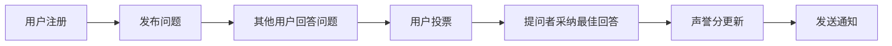

# 事件风暴工作坊结果

> 时间：2026-10-22
> 参与人：全员（PO、SM、龙、何、从）
> 方法：事件风暴（Event Storming）

---

## 0. 核心业务流程

---

## 1. 角色（Actor）

| 角色 | 说明 |
|------|------|
| 游客（Guest） | 未登录用户，只能浏览 |
| 学生用户（Student） | 登录用户，可以提问、回答、投票 |
| 提问者（Questioner） | 发布问题的学生 |
| 回答者（Answerer） | 回答问题的学生 |

---

## 2. 领域事件（Domain Events）

> 格式：过去式，描述已经发生的事情

### 问题上下文
1. 问题已发布（QuestionPublished）
2. 问题已编辑（QuestionEdited）
3. 问题已删除（QuestionDeleted）
4. 问题已被浏览（QuestionViewed）

### 回答上下文
5. 回答已发布（AnswerPublished）
6. 回答已编辑（AnswerEdited）
7. 回答已删除（AnswerDeleted）

### 投票上下文
8. 问题已被点赞（QuestionUpvoted）
9. 问题已被点踩（QuestionDownvoted）
10. 回答已被点赞（AnswerUpvoted）
11. 回答已被点踩（AnswerDownvoted）
12. 投票已取消（VoteCanceled）

### 采纳上下文
13. 回答已被采纳（AnswerAccepted）
14. 采纳已取消（AcceptanceCanceled）

### 标签上下文
15. 标签已创建（TagCreated）
16. 问题已添加标签（QuestionTagged）
17. 标签已从问题移除（TagRemovedFromQuestion）

### 用户上下文
18. 用户已注册（UserRegistered）
19. 用户声誉已更新（ReputationUpdated）

---

## 3. 命令（Commands）

> 格式：动词开头，描述用户触发的动作

| 命令 | 触发角色 | 对应事件 |
|------|----------|----------|
| 发布问题（PublishQuestion） | 学生 | 问题已发布 |
| 编辑问题（EditQuestion） | 提问者 | 问题已编辑 |
| 删除问题（DeleteQuestion） | 提问者 | 问题已删除 |
| 发布回答（PublishAnswer） | 学生 | 回答已发布 |
| 编辑回答（EditAnswer） | 回答者 | 回答已编辑 |
| 删除回答（DeleteAnswer） | 回答者 | 回答已删除 |
| 投票（Vote） | 学生 | 问题/回答已被点赞/点踩 |
| 取消投票（CancelVote） | 学生 | 投票已取消 |
| 采纳回答（AcceptAnswer） | 提问者 | 回答已被采纳 |
| 取消采纳（CancelAcceptance） | 提问者 | 采纳已取消 |
| 创建标签（CreateTag） | 学生 | 标签已创建 |
| 注册用户（RegisterUser） | 游客 | 用户已注册 |

---

## 4. 聚合与聚合根

### 聚合1：Question（问题聚合）
- **聚合根**：Question
- **包含实体**：Tag（标签值对象）
- **业务不变式**：
  1. 问题标题不能为空，长度10-200字
  2. 问题内容不能为空，长度至少20字
  3. 一个问题至少要有1个标签
  4. 只有提问者本人可以编辑/删除自己的问题

### 聚合2：Answer（回答聚合）
- **聚合根**：Answer
- **业务不变式**：
  1. 回答内容不能为空，长度至少10字
  2. 不能回答自己提的问题
  3. 只有回答者本人可以编辑/删除自己的回答
  4. 一个问题只能有一个被采纳的回答

### 聚合3：Vote（投票值对象）
- **值对象**：Vote
- **业务不变式**：
  1. 每个用户对每条内容只能投1票
  2. 投票类型只能是 UPVOTE 或 DOWNVOTE

### 聚合4：User（用户聚合）
- **聚合根**：User
- **值对象**：Reputation（声誉分）
- **业务不变式**：
  1. 用户名唯一
  2. 声誉分不能为负数
