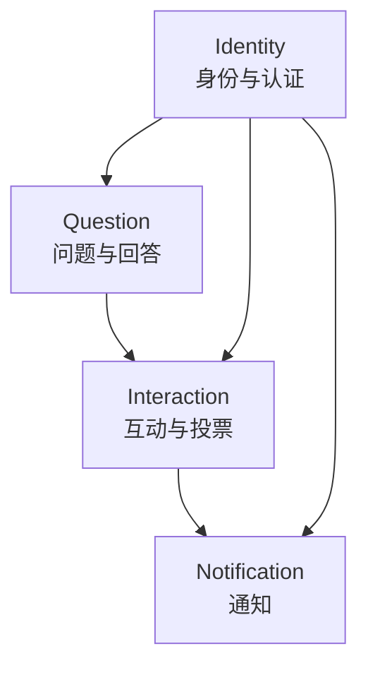

# 限界上下文与上下文映射

---

## 1. 限界上下文划分

CampusOverflow系统划分为以下4个限界上下文：

### 上下文1：Identity（身份与认证）
- **职责**：用户注册、登录、认证、用户基本信息
- **包含聚合**：User、Session
- **对外提供**：用户ID、用户名、用户角色

### 上下文2：Question（问题与回答）
- **职责**：问题发布、编辑、删除，回答发布、编辑、删除
- **包含聚合**：Question、Answer、Tag
- **依赖上下文**：Identity（需要知道是谁发布的）

### 上下文3：Interaction（互动与投票）
- **职责**：投票、采纳最佳回答、声誉分计算
- **包含聚合**：Vote、Acceptance
- **依赖上下文**：Question（操作问题/回答）、Identity（谁投的票）

### 上下文4：Notification（通知）
- **职责**：给用户发送通知（被回答、被采纳、被投票）
- **包含聚合**：Notification
- **依赖上下文**：Question、Interaction、Identity

---

## 2. 上下文映射图



### 关系说明：
- **Identity → Question**：Question上下文依赖Identity提供的用户信息
- **Question → Interaction**：Interaction上下文操作Question和Answer
- **Interaction → Notification**：互动事件触发通知

---

## 3. 模块划分建议（对应后端代码包结构）

```
com.campusoverflow
├── identity          # Identity上下文
│   ├── domain
│   ├── application
│   ├── infrastructure
│   └── interface
├── question          # Question上下文
│   ├── domain
│   ├── application
│   ├── infrastructure
│   └── interface
├── interaction       # Interaction上下文
│   ├── domain
│   ├── application
│   ├── infrastructure
│   └── interface
└── notification      # Notification上下文
    ├── domain
    ├── application
    ├── infrastructure
    └── interface
```
